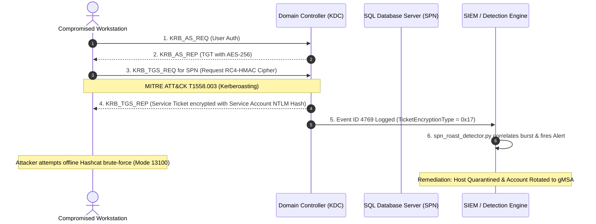

# Active Directory & Kerberos Threat Simulation & Defense Lab

An enterprise-grade laboratory and detection engineering toolkit designed for **Threat Hunters**, **SOC Tier-2/3 Analysts**, and **Red/Blue Team Engineers**. This lab models Active Directory identity attack paths, Kerberos protocol abuse (Kerberoasting, AS-REP Roasting, DCSync, Unconstrained Delegation), and provides production-ready audit and detection scripts.

---

## Lab Architecture & Threat Model

```
Active-Directory-Kerberos-Defense-Lab/
├── scripts/
│  ├── kerberos_ticket_auditor.py  # AD SPN cipher suite & account risk analyzer
│  └── spn_roast_detector.py    # Real-time Event ID 4769 RC4 anomaly detector
├── telemetry/
│  └── bloodhound_attack_path_analysis.json # Simulated SharpHound graph export
├── configs/
│  └── gpo_kerberos_hardening.md  # GPO baseline enforcing AES-256 and gMSA
└── README.md            # Architectural lab walkthrough
```

---

## Attack Vectors Simulated & Mitigated



### 1. Kerberoasting (MITRE ATT&CK T1558.003)
- **Mechanics:** Any authenticated domain account can request a Ticket Granting Service (TGS) ticket for any account with a registered `ServicePrincipalName` (SPN). If the account allows RC4 encryption, the ticket header contains an RC4 ciphertext that can be extracted into Hashcat format (`$krb5tgs$23$...`) and cracked offline.
- **Defense:** Mandatory migration to Group Managed Service Accounts (gMSA) with 128-character rotating passwords and setting `msDS-SupportedEncryptionTypes` to `0x18` (AES-256 CTS HMAC SHA1).

### 2. AS-REP Roasting (MITRE ATT&CK T1558.004)
- **Mechanics:** Accounts configured with `DONT_REQ_PREAUTH` (Kerberos pre-authentication disabled) allow unauthenticated attackers to request an AS-REP ticket for that username, yielding an offline-crackable hash (`$krb5asrep$23$...`).
- **Defense:** Automated audit and revocation of the `DONT_REQ_PREAUTH` flag.

### 3. Unconstrained Delegation
- **Mechanics:** Computers or service accounts with `TRUSTED_FOR_DELEGATION` store connecting users' TGTs in LSASS memory. If an attacker compromises this machine, they can extract cached Domain Admin TGTs.
- **Defense:** Enforce Resource-Based Constrained Delegation (RBCD) and place privileged administrators in the **Protected Users** security group.

---

## Running the Security Tools

### 1. Execute Account Risk Audit
```bash
python3 scripts/kerberos_ticket_auditor.py
```
Outputs structured JSON highlighting high-risk SPNs, legacy cipher allowances, and recommended remediation actions.

### 2. Run Real-Time 4769 Detection Engine
```bash
python3 scripts/spn_roast_detector.py
```
Simulates streaming ingestion of Windows Event ID 4769 logs, identifying high-frequency RC4 ticket requests and triggering SIEM escalation alerts.
