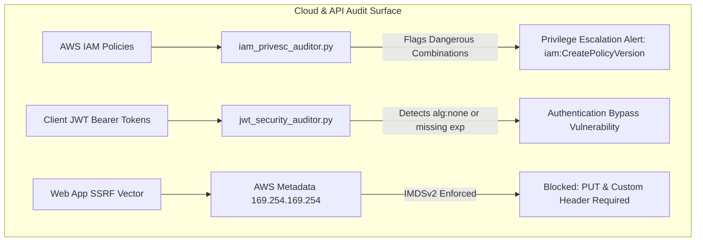

# Cloud Security & OWASP Top 10 API Audit Laboratory

A specialized cloud security engineering and application security (AppSec) laboratory. Focuses on **AWS IAM Privilege Escalation Detection**, **JWT Cryptographic Algorithm Exploitation & Defense**, and **Server-Side Request Forgery (SSRF) Cloud Metadata Hardening**.

---

## Lab Architecture

```
Cloud-Security-and-OWASP-Audit-Lab/
├── audit_scripts/
│   ├── iam_privesc_auditor.py       # Scans AWS IAM policies for 21 privilege escalation vectors
│   └── jwt_security_auditor.py      # Audits JWT tokens for 'none' alg, key confusion, & leaks
├── guides/
│   └── aws_imdsv2_ssrf_defense.md   # IMDSv2 metadata protection & Terraform baseline
└── README.md                        # Master lab documentation
```

---

## Attack & Audit Vectors



---

## Tool Execution

```bash
# Audit AWS IAM Policy Statements
python3 audit_scripts/iam_privesc_auditor.py

# Audit JWT Tokens for OWASP Flaws
python3 audit_scripts/jwt_security_auditor.py
```
